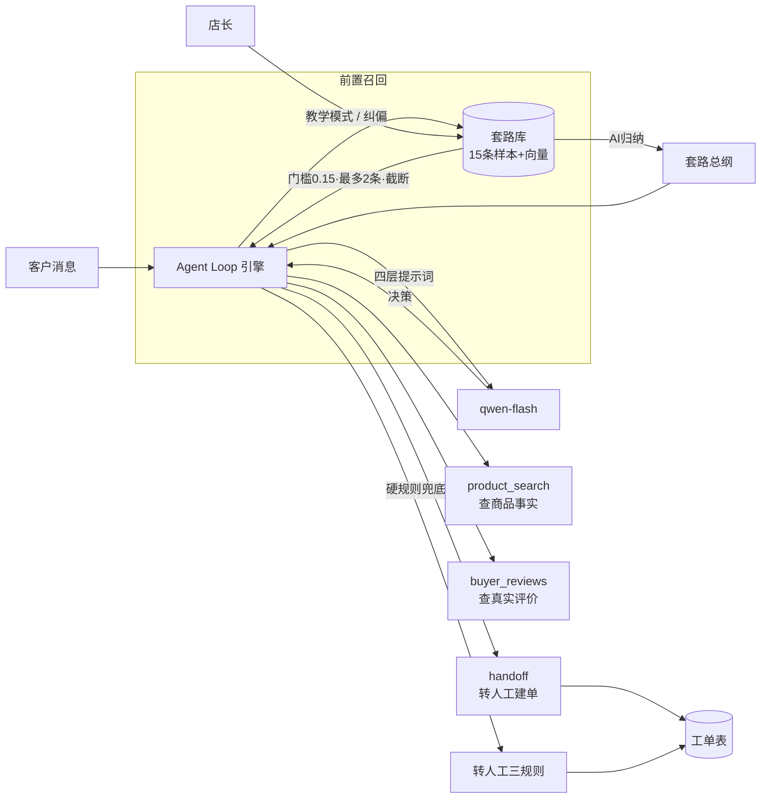

# Self-Evolving Customer Service Agent · 自进化电商客服系统

一个完整跑在线上的电商 AI 客服：店长把真人接待话术教给 AI，AI 上岗接待、被纠偏、超能力自动转人工建单——**教 → 用 → 纠 → 转** 的自进化闭环。

**技术栈**：FastAPI + qwen-flash（阿里云百炼）+ 自研 Agent Loop + SQLite + Nginx

## 项目背景

电商店铺客服有两个真实痛点：一是新手客服培训成本高，老店长的接待经验靠口口相传、人走经验就丢；二是售后场景机器人不能硬扛，客户明确要人工必须立刻给通道（合规 + 体验）。本系统把店长经验沉淀为可运营的"套路库"，AI 模仿套路自主接待，超出能力自动转人工落工单，经验随使用持续增长。

## 效果指标（线上实测）

| 指标 | 数值 | 说明 |
|---|---|---|
| 知识库命中率 | 80% 左右 | 每次对话落 metrics_log 实时统计，随使用量波动 |
| 转人工率 | 12%~15% | 超出 AI 能力范围自动建单（含客户主动要人工） |
| 单轮上下文注入 | 900 字 → 400 字 | 召回门槛 + 注入裁剪优化后 |
| 历史上下文 | 封顶 6 条 | 滑动窗口，永不膨胀 |
| 验收综合分 | 1.000（20 题） | 固定评估集跑分，8 次实测无退步 |

## 架构



一条消息的旅程：**强制召回选参考 → 四层拼提示词 → 模型决策调工具 → 硬规则兜底 → 落库留痕**。

## 核心特性

- **Agent Loop 决策循环**：模型在"召回 → 组装提示词 → 决策 → 调工具 → 观察 → 再决策"中循环，最多 6 步、30 秒超时；每一步的思考与工具调用全程留痕（轨迹面板可视化）。
- **强制前置召回（RAG）**：每轮对话由引擎在第 0 步自动查套路库（应用层余弦相似度），0.15 相似度门槛过滤低质样本，只注入最相关 2 条、话术截断——每轮上下文从约 900 字压到 400 字。
- **转人工三规则**（代码级硬规则，不依赖模型自觉）：① 客户明确要求（关键词命中零挽留）；② 同工具同参数连调两次（判定模型答不出）；③ 连续两轮召回为空（判定超出能力范围）。任一触发即建工单落库。
- **会话隔离与上下文管理**：每标签页独立会话 ID + 6 条滑动窗口，历史永不膨胀、窗口之间互不串扰。
- **自进化学习闭环**：教学模式（正向教话术+策略）、纠偏（错题订正）、AI 自动归纳套路总纲；商品事实只来自工具查询，禁止编造。
- **可观测性**：每个用户问题的完整 Agent 轨迹（工具入参/出参/分数/决策）可在界面展开；命中率、转人工率等指标实时统计落库。

- **自学习验收（双闸 + 回滚 + 台账）**：新学的样本先进待验证区，跑 20 题固定评估集做影子放行（含总纲重算），综合分跌幅超阈值即拒绝生效；通过后由店长确认才转正，出事可整批回滚。判分与判定自带确定性自检（`scripts/test_gate.py`）。

## 快速开始

```bash
pip install -r requirements.txt
cp .env.example .env   # 填入模型 API Key（支持百炼/OpenAI 兼容接口）
python run.py          # 默认 http://127.0.0.1:8000，账号 admin/admin123
```

## 目录结构

```
app/
  agent/          # Agent Loop 引擎、工具定义（召回/商品/评价/转人工）
  services/       # 会话管理、套路库召回（向量+余弦）、工单、指标
  knowledge/      # embedding 抽象层（稠密/稀疏双实现，可平迁 pgvector）
  db.py           # 数据访问
static/           # 前端（聊天 + 轨迹面板 + 教学模式 + 后台面板）
docs/             # 架构设计文档与深度解读（见下）
```

## 设计文档索引

- `docs/系统架构思路-通俗版.md` —— 整体架构入门
- `docs/项目架构解读-AI-Agent.md` —— 分层解读
- `docs/架构深度解读/` —— 10 篇专题：自进化机制、RAG 召回、上下文管理、延迟治理、套路总纲治理等
- `docs/指挥复盘-我是如何指挥AI做出这个项目的.md` —— 项目指挥与迭代过程
- `docs/演示用例.md` —— 端到端演示动线

## 工程取舍说明

- **数据库**：单机演示选 SQLite（零部署零运维），数据访问层已抽象，上量平迁 MySQL/PG；向量存 JSON 应用层算余弦，预留 pgvector 替换点。
- **模型**：Provider 抽象层，换基座模型只改 `.env` 配置。
- **账号**：演示单店长账号走配置文件 + SHA256 加盐 Cookie，多账号即建 users 表（密码哈希）。
